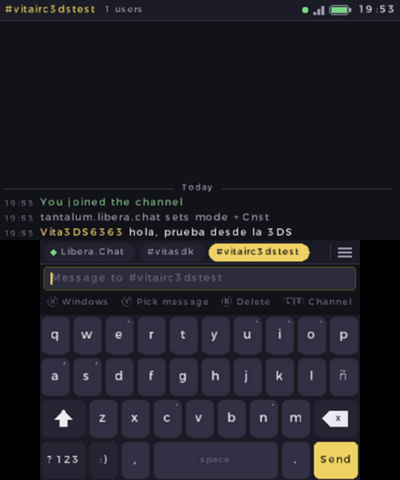
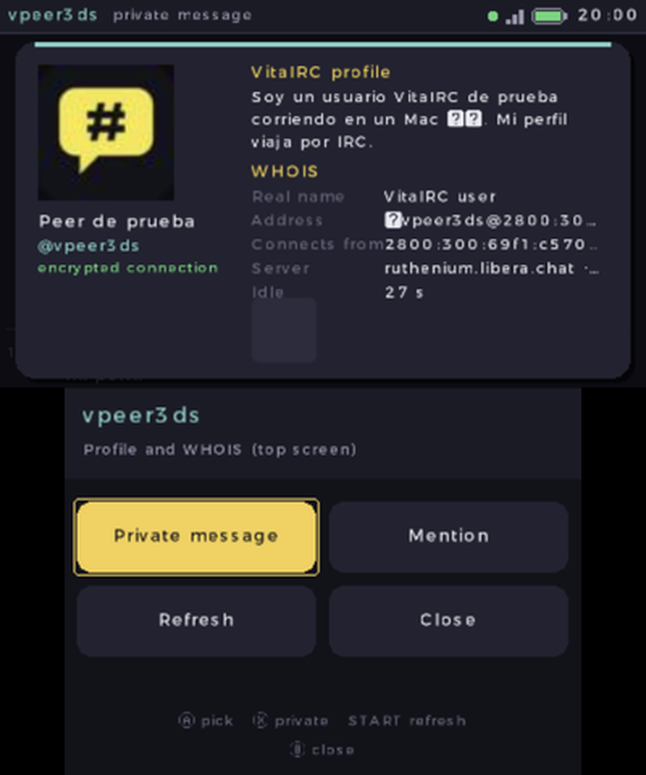

# VitaIRC para Nintendo 3DS

Cliente de IRC para la familia Nintendo 3DS (Old y New 3DS, 2DS): la conversación en la pantalla de
arriba y un teclado pensado para la pantalla táctil abajo. Es
[VitaIRC](https://github.com/ArchelKrozt/VitaIRC), el cliente de PS Vita, con el mismo núcleo de IRC,
y se entiende con VitaIRC para [Android](https://github.com/ArchelKrozt/VitaIRC-Android) y
[iPhone](https://github.com/ArchelKrozt/VitaIRC-iOS).

[Read in English](README.md)

| | |
|---|---|
|  |  |

## Funciones

- **Dos pantallas**: el chat sigue arriba mientras escribes, cambias de ventana o miras la tarjeta
  de alguien.
- **Teclado táctil**: desliza el dedo para corregir antes de soltar; mantén una vocal para los
  acentos (á é í ó ú ü) y la n para la ñ; bloqueo de mayúsculas, números, símbolos y emoticonos.
- **Sugerencias de nicks** mientras escribes: tócalas para completarlo.
- **Pestañas de ventanas** con contadores (en rojo si te mencionan): arrástralas, tócalas o usa L/R.
- **Panel** (☰ o X): todas las ventanas de todos los servidores, los usuarios del canal con acciones
  de operador, y el menú.
- **Elegir un mensaje** con Y para responder (citado, IRCv3 `+draft/reply`), mencionar, traducirlo,
  copiarlo o abrir la tarjeta de quien lo escribió.
- **Tarjeta de usuario**: el WHOIS y su **perfil VitaIRC** (nombre, bio, foto, favoritos públicos),
  flotando sobre el chat.
- **Mi perfil**: nombre, bio y compartir sí/no; otros usuarios de VitaIRC te lo piden por el mismo
  IRC ([protocolo](docs/PROFILE-PROTOCOL.md)).
- Varios servidores, SSL/TLS, SASL / NickServ / contraseña de servidor, redes predefinidas,
  reconexión automática, explorador de canales con búsqueda.
- IRCv3 con bouncers (soju, ZNC): lo que te perdiste llega con su hora real.
- **Traducción** con Google (gratis) o ChatGPT.
- **Buscador de imágenes** en Safebooru, Danbooru y Sankaku: favoritos, guardar en la SD y enviar al
  chat con el nombre del artista. El contenido adulto solo tras confirmar 18+ en Ajustes.
- Historial en la SD, colores de mIRC, palabras de alerta, ignorados, sonido en menciones, español
  e inglés.

## Controles

| Botón | Acción |
|---|---|
| A | Enviar |
| B | Borrar / volver |
| L / R | Ventana anterior / siguiente |
| Cruceta ↑↓, Circle Pad | Mover el chat (← → mueven el cursor) |
| X | Ventanas, usuarios y menú |
| Y | Elegir un mensaje de arriba |
| START | Menú |
| SELECT | Ir a la ventana con mensajes nuevos |

## Instalar

Necesitas una 3DS con custom firmware ([3ds.hacks.guide](https://3ds.hacks.guide/es_ES/)).

- **Menú HOME**: descarga `VitaIRC.cia` de [Releases](../../releases) e instálalo con FBI.
- **Homebrew Launcher**: copia `VitaIRC.3dsx` a `sdmc:/3ds/`.

La primera vez se conecta a Libera.Chat y entra a `#vitasdk`. Los ajustes y servidores quedan en
`sdmc:/3ds/VitaIRC/config.ini`.

La 3DS apaga el Wi-Fi al cerrar la tapa, así que la conexión se corta; VitaIRC se reconecta al
abrirla. Con un bouncer no te pierdes nada.

## Compilar

Ver [README.md](README.md#building).
