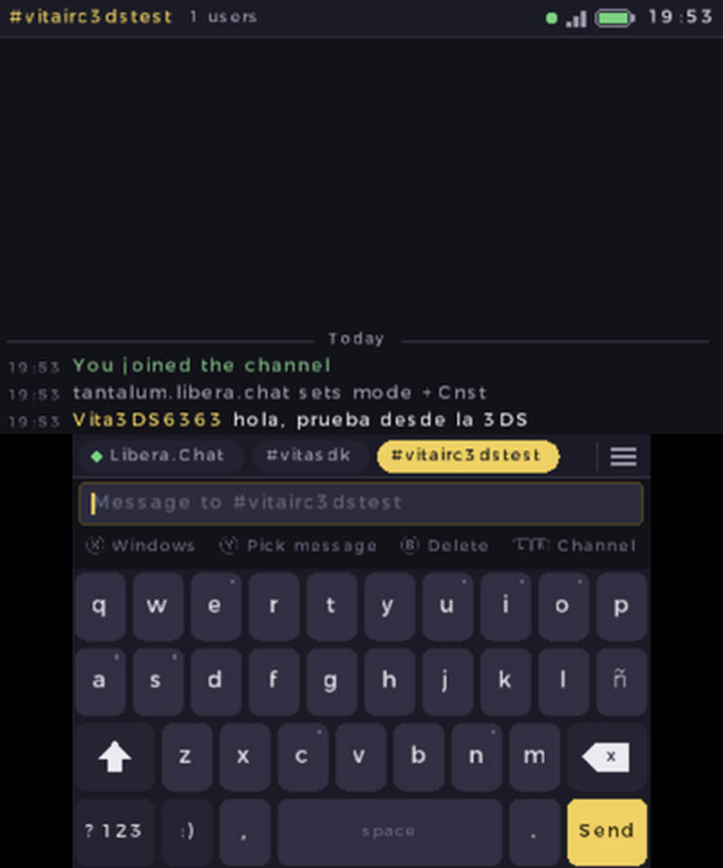
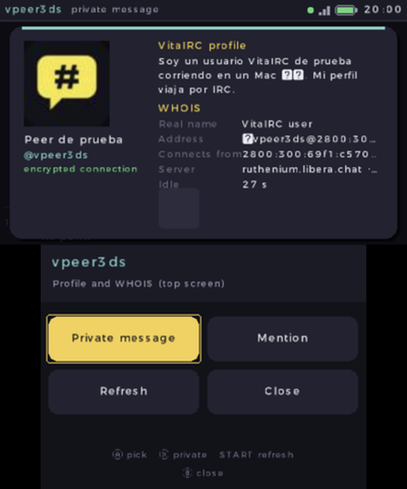
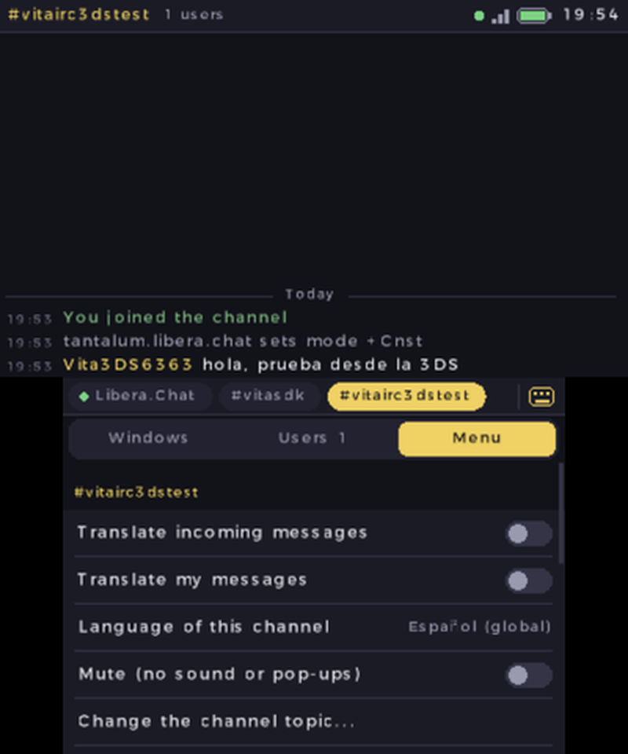
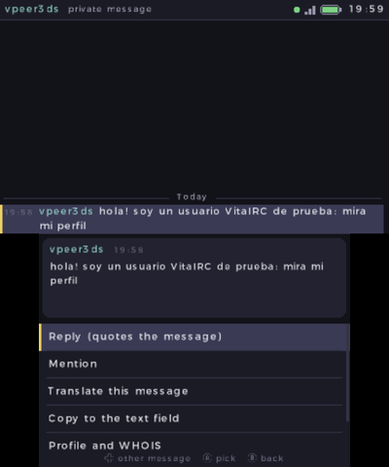

# VitaIRC for Nintendo 3DS

An IRC client for the Nintendo 3DS family (Old and New 3DS, 2DS): the conversation on the top
screen, and a keyboard made for the touch screen below it. It is
[VitaIRC](https://github.com/ArchelKrozt/VitaIRC), the PS Vita client, with the same IRC core, and it
talks to VitaIRC for [Android](https://github.com/ArchelKrozt/VitaIRC-Android) and
[iPhone](https://github.com/ArchelKrozt/VitaIRC-iOS).

[Leer en español](README.es.md)

| | |
|---|---|
|  |  |
|  |  |

## Features

- **Two screens**: the chat stays on top while you type, switch windows or read a user's card.
- **Keyboard for the touch screen**: slide your finger to fix a key before letting go; hold a vowel
  for accents (á é í ó ú ü) and n for ñ; caps lock; numbers, symbols and emoticons.
- **Nick suggestions** while you type: tap one to complete it.
- **Window tabs** with unread counters (red for mentions); drag them, tap them, or use L/R.
- **Panel** (☰ or X): every window of every server, the channel's users with operator actions,
  and the menu.
- **Pick a message** with Y to reply (quoted, IRCv3 `+draft/reply`), mention, translate it, copy it,
  or open the sender's card.
- **User card**: WHOIS and the user's **VitaIRC profile** (name, bio, picture, public favorites),
  floating over the chat.
- **My profile**: name, bio, share on/off; other VitaIRC users ask for it over IRC itself
  ([protocol](docs/PROFILE-PROTOCOL.md)).
- Several servers, SSL/TLS, SASL / NickServ / server password, presets for the big networks,
  automatic reconnection (also after closing the console), channel browser with search.
- IRCv3: `server-time`, `batch`, `message-tags`, `draft/chathistory` (with a bouncer such as soju
  you get what you missed), reactions shown under messages.
- **Translation** with Google (free) or ChatGPT: incoming messages, your own, or one message.
- History kept on the SD card, mIRC colors, highlight words, ignore list, a chime for mentions,
  English and Spanish.

## Controls

| Button | Action |
|---|---|
| A | Send |
| B | Delete / back |
| L / R | Previous / next window |
| D-pad ↑↓, Circle Pad | Scroll the chat (← → move the text cursor) |
| X | Windows, users and menu |
| Y | Pick a message on the top screen |
| START | Menu |
| SELECT | Go to the window with new messages |

## Install

You need a 3DS with custom firmware ([3ds.hacks.guide](https://3ds.hacks.guide)).

- **HOME menu**: download `VitaIRC.cia` from [Releases](../../releases) and install it with FBI.
- **Homebrew Launcher**: copy `VitaIRC.3dsx` to `sdmc:/3ds/`.

The first time it connects to Libera.Chat and joins `#vitasdk`. Settings and servers are in
`sdmc:/3ds/VitaIRC/config.ini`.

The 3DS turns Wi-Fi off when you close it, so the connection drops; VitaIRC reconnects when you open
it again. With a bouncer you don't miss anything in between.

## Building

Install [devkitPro](https://devkitpro.org/wiki/Getting_Started) with `3ds-dev`, `3ds-mbedtls`,
`3ds-curl` and `3ds-zlib`, then:

```sh
./build.sh          # dist/VitaIRC.3dsx
```

The `.cia` is built by GitHub Actions (`.github/workflows/build.yml`), which also publishes both files
for tags `v*`.

`core/` is VitaIRC's shared core (IRC, TLS, settings, history, translation, profiles), copied from the
PS Vita sources by `tools/sync_core.sh`; don't edit it here. `source/` is the 3DS app: `compat/` stands
in for the few Vita system calls the core makes, and `ui/` holds the screens.

## License

MIT. Uses [stb_image](https://github.com/nothings/stb) (public domain), mbedTLS and libcurl.
